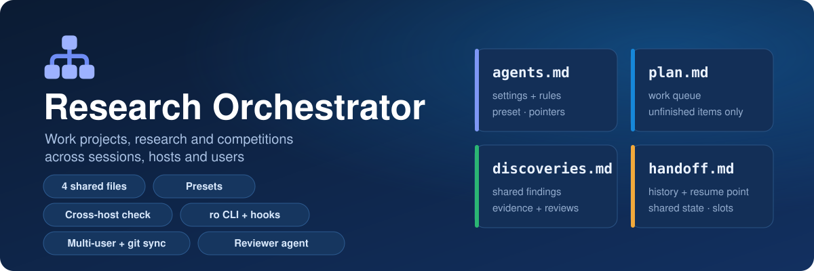
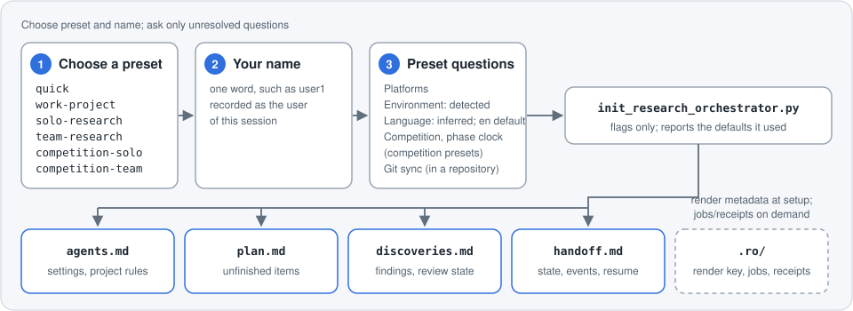
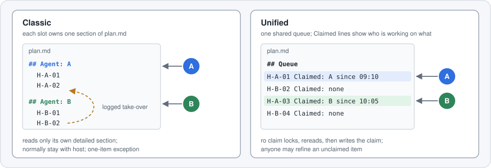
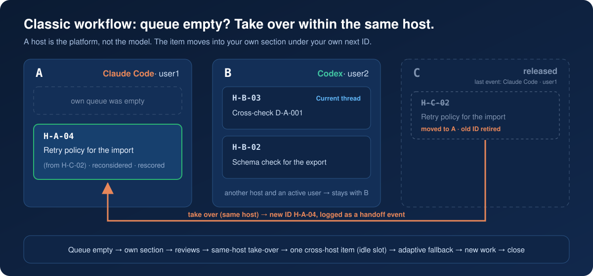
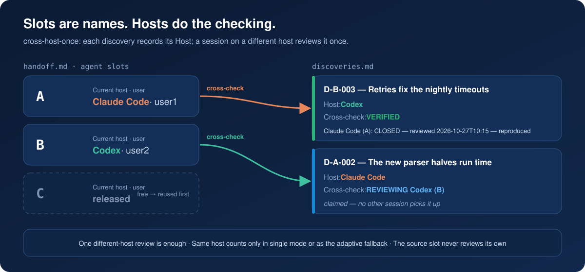
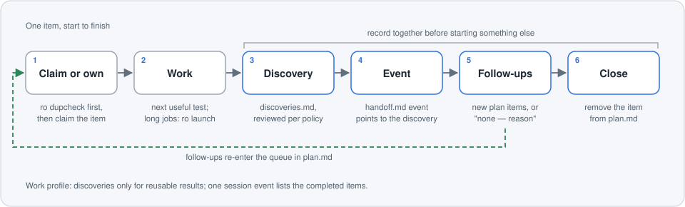
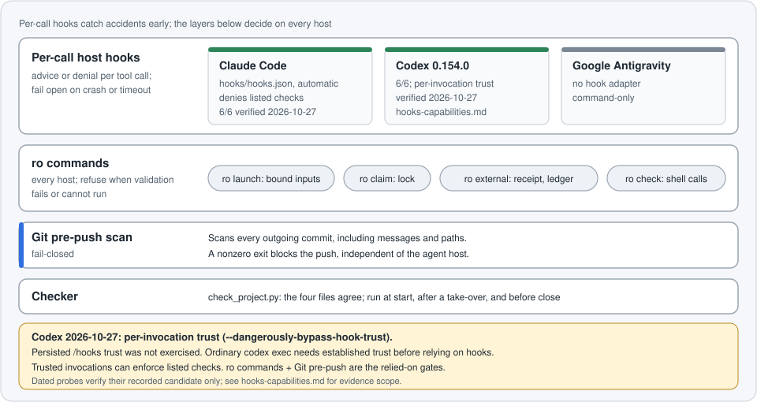

<p align="center">
  <a href="README.md">English</a> · <a href="README.ko.md">한국어</a> · <a href="README.zh-CN.md">简体中文</a> · <b>日本語</b>
</p>

<p align="center">
  
</p>

# Research Orchestrator

Claude Code、Codex、Google Antigravity 向けのプラグインで、業務プロジェクト・研究・コンペティションの作業を複数の AI セッションにわたって途切れさせずに進めます。スキル、ホストフック、`ro` コマンドラインツール、読み取り専用のレビュアーエージェントをまとめて提供します。4 つの Markdown ファイルが設定、作業キュー、再利用できる知見、永続的な引き継ぎ記録を保持します。プリセットは、セッションがキューを分け合う方法、知見をレビューする主体、適用する根拠チェックを決めます。

**リリース 6.0.1。** 5.1.0 からの変更点は [CHANGELOG.md](CHANGELOG.md) にあります。既存プロジェクトはそのまま動作します。設定を変える前に、下の移行セクションを読んでください。

## なぜ使うのか

<p align="center">
  
</p>

共有の記録がないと、新しい AI セッションは毎回ゼロから始まります。文脈が失われ、同じアイデアが二度試され、1 つのモデルの未検証の主張が計画を左右し、どの結果が最新なのか誰にも分かりません。Research Orchestrator は、その状態をどのセッション、ホスト、ユーザーでも読める 4 つのプレーンなファイルに保ちます。作業は記録された再開地点から続き、新しい項目の前に重複チェックが入り、他の人が知見に頼る前に別のセッションやホストがレビューでき、現在のベストのようなプロジェクト全体の値は 1 か所にあります。数日にわたる業務プロジェクト、研究、コンペティションのどれでも同じです。

## インストール

`PATH` に Python 3.12+(CI で検証した最小バージョン)が必要です。Claude Code プラグインでインストールするか、チェックアウトから `python install.py --host claude-code`、`python install.py --host codex`、`--host both` のいずれかを実行します。スキルフォルダーだけをコピーしてもフックは入りません。

Windows: Git Bash (`sh`) のインストールも必要です。

### Claude Code プラグイン(推奨)

Claude Code 内で実行します:

```text
/plugin marketplace add TaeyanG4/research-orchestrator
/plugin install research-orchestrator@research-orchestrator
```

GitHub リポジトリがマーケットプレイスになります。プラグインはフックと `ro-reviewer` エージェントを登録し、更新はプラグインのバージョンに従います。インストール後に新しいセッションを開始してください。`ro brief` が `hooks active` を報告するはずです。

`ro` シムがない場合、SessionStart と `ro brief` がインストール済みプラグイン用の正確な `--shim-only` コマンドを表示します。このコマンドはスキルやフックをコピーせずに、そのランタイムへの `ro` エントリーポイントを作成します。

### Codex

チェックアウトまたは展開したリリースから実行します:

```bash
python install.py --host codex
```

このコマンドはスキルとフック設定をまとめてインストールします。任意の Codex マーケットプレイスプラグイン(`codex plugin marketplace add TaeyanG4/research-orchestrator`)はフックを登録しません。インストールしたフックを `/hooks` で信頼してください(バージョンによっては先に `features.hooks` を有効化)。信頼するまでは `ro` コマンドと Git pre-push に頼ってください。[ホストの証拠と信頼範囲](skills/research-orchestrator/references/hooks-capabilities.md)を参照してください。

### プラグインを使わない場合

```bash
git clone https://github.com/TaeyanG4/research-orchestrator.git
cd research-orchestrator
python install.py --host both
```

`--host` には `claude-code`、`codex`、`both`(既定)を指定でき、既定の範囲はユーザーアカウントです。`--project <dir>` は代わりにプロジェクトへインストールし、共有ディスパッチャーの背後にそのプロジェクトの Git pre-push ゲートを登録します。入れ子のフォルダーは何も書き込む前に拒否されるため、リポジトリのルートを指定してください。プロジェクトの `.claude/` をコミットすると Claude Code の設定を共有できます。Codex のプロジェクトフックは絶対パスを使うため、チェックアウトを移動したら再インストールしてください。ユーザー単位のインストールでは、リポジトリごとにゲートを別途設置します。

その他のオプション: `--dry-run` は変更を事前に表示し、`--uninstall` はインストール内容をバックアップへ移し、`--no-hooks` はホストと Git のフックなしでスキルとシムをインストールし、`--remove-hooks` は手動のホストフックだけを削除し(スキル、Git ゲート、他のフックは維持)、`--no-shim` は既定の `ro` シムを省きます。インストーラーは他のフックを保持し、置き換えるものをバックアップします。Claude Code プラグインが有効なら、重複した手動登録を削除します。既存の独自 pre-push フックはそのまま残し、[pre-push サンプル](hooks/pre-push.sample)を統合する手順を案内します。

### リリースとオフライン利用

`main` は最新の安定版で、タグは `vX.Y.Z` 形式です。各 GitHub Release には CHANGELOG の内容と zip アセットがあります。オフラインでは [GitHub Releases](https://github.com/TaeyanG4/research-orchestrator/releases) の zip を展開し、そのフォルダーで同じ `install.py` コマンドを実行します。インストールせずにプラグインを試すには:

```text
claude --plugin-dir <folder>
```

### Google Antigravity

`skills/research-orchestrator/` を `<project>/.agents/skills/research-orchestrator/`、またはグローバルの `~/.gemini/config/skills/research-orchestrator/` にコピーします(旧 CLI の場所: `~/.gemini/antigravity-cli/skills/research-orchestrator/`)。`/skills` で検出を確認できます。初期化は Antigravity のセッションを検出し、ホストとして記録します。インストール先オプションやフックアダプターはないため、`ro` を使い、[Git pre-push ゲート](skills/research-orchestrator/references/publication-safety.md)を手動で設置してください。

## クイックスタート

インストール後、プロジェクトのフォルダーでエージェントに Research Orchestrator の初期化を依頼するか、同じ手順を自分で実行します。`<skill-root>` は `SKILL.md` を含むインストール先フォルダーで、`ro` は `python <skill-root>/scripts/ro.py` を指します。

```text
python <skill-root>/scripts/init_research_orchestrator.py . --preset work-project --user user1
python <skill-root>/scripts/check_project.py .
ro --slot A brief
ro --slot A next-id H
ro --slot A claim <item>
ro --slot A close
```

初期化ツールは次のセクションで説明する 4 つのファイルを書きます(`--list-presets` で他のプリセットを確認できます)。`ro brief` は設定、フックの状態、スロットの選択、確保、ジョブ、チェッカーの件数を復元します。`ro next-id H` は `plan.md` に新しく書く項目の ID を予約し、`ro claim` はその項目を自分のスロットで確保し(unified ワークフローのみ)、`ro close` は使っていない確保を解放してチェッカーを実行し、残りを報告します。エージェントはセッションごとにこの流れを繰り返し、完了した項目は下の項目のライフサイクルに従って記録します。

## 4 つのファイル

どのプロジェクトも、調整の状態をプロジェクトのルートにある小文字の Markdown ファイル 4 つに保ちます。`.ro/` は調整情報ではなく、ツールの状態(ジョブ、レシート、予約、ロック、チェッカーのベースライン)を保持します。

| ファイル | 内容 | 編集する主体 |
| --- | --- | --- |
| `agents.md` | プリセットの要約、設定、読み込み先の案内、ユーザーが所有する `## Project rules` 領域(常設ルール、期限付きの例外、1 行の教訓) | 初期化ツールが設定と案内を書き、`--reconfigure` が手で編集した値を反映します。`## Project rules` 以降はユーザーのもので、再生成されません |
| `plan.md` | 未完了の項目のみ。完了した項目はキューから外れます | classic: 各スロットが自分の `## Agent:` セクション(記録された引き継ぎを含む)。unified: 他のアクティブなスロットが確保した項目を除き、どのスロットでも |
| `discoveries.md` | 根拠とレビュー状態を伴う再利用可能な知見 | 元のスロットが項目を書き、改訂します。適格なレビュアーがレビュー行を加え、`Cross-check` を設定します |
| `handoff.md` | 共有状態、イベント履歴、外部アクション、各スロットの再開地点 | 各スロットは自分の `### Agent:` セクションだけを編集します。すべてのセッションがイベントを追記し、Shared state の値を更新します |

共有ファイルを編集する前に読み直し、該当するセクションだけを直すか項目を追記してください。古いコピーが他のセッションの作業を上書きしないようにするためです。事実は一度だけ書き、他の場所からはそこを指します。[記録と共有ファイルの編集](skills/research-orchestrator/references/records.md)。

## プリセット

プリセットは `agents.md` の設定ブロックを埋め、すべての値はそこで確認・編集できます。*Profile* は作業の種類、*workflow* はセッションがキューを分け合う方法、*verification* は知見を誰がレビューすべきかを表します。

| プリセット | 用途 | Profile | Workflow | Item size | Guards | Verification |
| --- | --- | --- | --- | --- | --- | --- |
| [`quick`](examples/quick-script-cleanup/README.md) | 1 つのエージェントによる短い作業 | work | classic | short | off | self |
| [`work-project`](examples/work-project-data-migration/README.md) | 数日にわたる移行・分析・構築 | work | unified | staged | light | independent-review |
| [`solo-research`](examples/solo-research-literature-replication/README.md) | 1 つのエージェントによる長期研究(研究に推奨) | research | unified | staged | light | independent-review |
| [`team-research`](examples/team-research-cv-leakage/README.md) | 複数のセッションやホストによる並行作業(5.1.0 の方式) | research | classic | short | light | cross-host-once |
| [`competition-solo`](examples/competition-solo-tabular/README.md) | 主に 1 つのエージェントで進めるコンペティション | competition | unified | staged | light | independent-review |
| [`competition-team`](examples/competition-team-forecasting/README.md) | 並行セッションやホストが参加するコンペティション | competition | classic | short | light | hybrid |

- **強制:** すべてのプリセットは `Enforcement: block` と `Block: shell.background, shell.heredoc, jobs.mutate-bound, publish.scan` を使い、コンペティション用プリセットは `external.gate` を加えます。
- **プラットフォーム:** ソロ用プリセットは検出した 1 つのプラットフォームで動き(`Cross-check fallback: same-host`)、チーム用プリセットの既定値は `Claude Code, Codex` です(`wait`)。
- **レシート:** `Receipt policy` は `competition-solo` では `self`、それ以外では `independent` で、`independent` では別のセッションが成果物のレシートに署名する必要があります。
- **サブエージェント:** 計画収集とレビュアーは `off` で始まり、キューの上限は `stop at 50, resume at 5` です。
- **カスタムと保存済みプリセット:** `custom` または省略時は、新規プロジェクトに軽量な作業設定と単一の検出ホストを使い、既存プロジェクトは互換設定を維持します。`--save-preset <name>` で保存し、`--preset user:<name>` で再利用できます。

各プリセットは実例プロジェクトにリンクしています。[設定、優先順位、ユーザープリセット](skills/research-orchestrator/references/presets.md)。

## セットアップ

インストール後、エージェントに Research Orchestrator の初期化を依頼してください。エージェントは次の回答をまとめて集め、すでに伝えた内容は省きます。

1. **プリセット**: 上の 6 つのいずれか(`--list-presets` は保存済みプリセットも表示します)。
2. **名前**: このセッションのユーザーとして記録される 1 語、例: `user1`。
3. **残るプリセットの質問**: プラットフォーム、`Environment`、`Language` は検出情報と依頼から推定し、明示された答えがなく検出が失敗または曖昧な場合だけ尋ねます。既定値は `Info:` で表示します(`Language` は `en`)。コンペ用は競技とフェーズ時計も必要です。Git 同期はリポジトリ内でのみ尋ねます。`quick` はプリセットと名前、リポジトリ内では Git 同期だけが必要です。

その後、エージェントが初期化ツールを実行します。初期化ツールはフラグだけを受け取り、質問はしません。`<skill-root>` は `SKILL.md` を含むインストール先ディレクトリです。`--answers` は同じ回答を JSON オブジェクトまたはファイルで受け取り、キーはアンダースコア付きの設定名と `name`、`user`、`agents`、`ordering` です。明示的なフラグがそのキーを上書きします。回答が足りないと、エラーが完全なコマンド例を表示します。

```text
python <skill-root>/scripts/init_research_orchestrator.py --list-presets
python <skill-root>/scripts/init_research_orchestrator.py . -n "<project>" --preset work-project --user <user> --platforms "<host>" --environment linux/bash --language en
python <skill-root>/scripts/init_research_orchestrator.py . --answers answers.json
python <skill-root>/scripts/check_project.py .
```

<p align="center">
  
</p>

初期化ツールは 4 つの調整ファイルを書き、レンダリング情報を `.ro/` に保存します。`Language` は自由文だけに適用されます。見出し、フィールド名、ID、状態語、検査 ID、設定キーは、チェッカー、フック、`ro` が動作するよう英語を保ちます。

## ワークフロー

スロット(`A`、`B`、… `AA`)はツールや人ではなく作業の系統の名前なので、どのホストでもスロットを引き継げます。

<p align="center">
  
</p>

### Classic

各スロットは `plan.md` の `## Agent: <slot>` セクションを 1 つ所有し、自分のセクションの詳細だけを読みます。重複チェック、割り振り、引き継ぎでは限られたメタデータだけを読みます。項目の所有者は記録された引き継ぎでのみ変わり、別のホストがキューに入れた項目は通常そのホストに残ります。これが 5.1.0 の動作であり、`Workflow` 行がないプロジェクトの既定値です。[Classic ワークフロー](skills/research-orchestrator/references/workflow-classic.md)。[別ホストの1項目を引き継ぐ例外](skills/research-orchestrator/references/workflow-classic.md#cross-host-take-over-by-judgment)には、元ホストの待機状態、近い作業の消化、記載の適格条件が必要です。

### Unified

1 つの `## Queue` がすべての項目を保持し、各項目は `Claimed: none` または `Claimed: <slot> since <time>` で始まります。`ro claim` はプロジェクトのロックを取り、キューを読み直してから確保を書き込むため、2 つのスロットが同じ項目を確保することはできません。未確保の項目は誰でも改善できますが、他のアクティブなスロットが確保した項目は誰も編集しません。[Unified ワークフロー](skills/research-orchestrator/references/workflow-unified.md)。

どちらのワークフローでも、`Item size: staged` では長い項目が `Stages:` を宣言して段階イベントを記録できます。`Important stages:` に指定した段階は、正確な `:before` 範囲の独立したレシートがある場合にのみ起動でき、`Receipt policy: self` でも同じです。決定を変えた段階は `Decision: changed` を含む独自の日付付きイベントと知見を残し、その項目の次の起動前に独立した `:after` レシートが必要です。[段階的な項目](skills/research-orchestrator/references/staged-items.md)。

`Workflow` を変えると項目が移動するため、`--reconfigure --migrate` が必要です。

## スロットとセッション

スロット名は `A` から `Z`、続いて `AA` から `ZZ` です。1 つのエージェントによる作業は `A` を使い、新しいスロットを作る前に解放済みのスロットを再利用します。各スロットは `handoff.md` に `### Agent: <slot>` セクションを 1 つ持ち、そこに `Current host`(モデルではなく Claude Code や Codex のようなプラットフォーム)、`Current user`(セッションを実行する人)、`Current thread`、`Resumable state`、`Blocker`、`Next action` があります。`Current host` が `unassigned` または `released` のときだけ空きスロットで、それ以外の値は、セッションが止まっているように見えても確保済みを意味します。

**新しいセッション。** 明示したスロットや継続/並列の意図はそのまま従い、古くない適格スロットが 1 つだけなら自動で引き受けます。それ以外の場合、SessionStart と `ro brief` が候補ごとに所有者、最終活動、実行中のジョブを示し、エージェントは 1 つの質問をします: スロットを継続(セッションが終わっていれば回収)、並列スロットを開始、指定したスロットを使用。確保済みのスロットは、保護されたジョブがなく `Stale slot after`(既定 `2h`)以内にイベントも確保もないとき古いとみなします。回収は記録され、確保、再開状態、ジョブを保持します。`Autonomy: away` では尋ねずに新しい並列スロットを開始し、後で判断できるようその選択を記録します。[セッション](skills/research-orchestrator/references/sessions.md)。

**読み取りルール (classic)。** セッションは自分の計画セクションと引き継ぎセクションをすべて読みます。他のアクティブなスロットについては、割り振りや引き継ぎのための項目メタデータ、重複チェックのための見出しと `Hypothesis`/`Goal` 行、そして `Current host`、`Current user`、`Current thread` 行だけを読みます。再開状態や詳しい根拠は読まないため、それぞれの推論の系統が独立したまま保たれます。新しい項目と後続項目は、自分のセクションに自分の ID で追加します。

**引き継ぎ (classic)。** 自分のキューが空になったら、自分のセクションを読み直し、適格なレビューを引き受け、それから同じホストのスロットの待機中の項目を引き継ぎます。対象は、`Current host` が自分のホストで自分のユーザーが実行しているスロット、または最新のイベントが自分のホストから出たか、まだイベントがない released か unassigned のスロットです。所有者の `Current thread`、`Active compute` の確保がかかった項目、別のユーザーが実行中のスロットの項目は決して取りません。項目は次の ID で自分のセクションに移し、タイトルに古い ID を付け(`H-A-05 — Retry policy for the nightly import (from H-C-03)`)、古い ID は廃止し、項目を見直してスコアを付け直し、引き継ぎを引き継ぎイベントとして記録します。別ホストの項目は、近い作業を使い切った後、待機中のスロットからだけ、判断により 1 つ引き継げます。

<p align="center">
  
</p>

**ホスト間の検証。** `cross-host-once` では、すべての知見が `Host` を記録し、別のホストのセッションが 1 回レビューします。同じホストのセッションは同じ盲点を共有するためです。レビュアーはまずレビューを確保し(`Cross-check: REVIEWING <host> (<slot>)`)、他のセッションが取らないようにしてから、日付付きのレビュー行を追加して状態を設定します。元のスロットは自分の知見をレビューしません。同じホストのレビューは single モード、または adaptive の `Cross-check fallback: same-host` でのみ有効で、`same host —` で始まります。

<p align="center">
  
</p>

[Classic ワークフロー](skills/research-orchestrator/references/workflow-classic.md)、[検証](skills/research-orchestrator/references/verification.md)。

## 記録の形式

フィールド名、ID、状態語は英語のままで、自由文は `Language` に従います。ID は `ro next-id` で予約します。項目は `H-<slot>-<NN>`、知見は `D-<slot>-<NNN>` で、作成したスロットが番号を振り、再利用しません。

**計画項目、簡潔な形** (work プロファイル、または `Ordering: queue` の計画)。`Claimed` は unified ワークフローにのみあります:

```markdown
### H-A-02 — Retry policy for the nightly import
- Claimed: A since 2026-10-27 09:10
- Goal: make the nightly import retry transient failures
- Evidence: two of the last ten runs failed on a network timeout
- Next test: add bounded retries and replay one failed day
```

**計画項目、スコア付きの形** (優先度で順位を付ける研究とコンペティション)。各要素は 0〜3 の整数で、`Priority = 2*Impact + 2*Information + Confidence + Unblock + Diversity + (3-Cost)`(0〜24)です。スコアが最も高い項目が先で、同点なら `Cost` が低い方、次に `Information` が高い方です。省略したルーティングのフィールドは `CPU`、`NO`、`NONE` を意味します:

```markdown
### H-A-04 — Repeat the speed-up with a cold cache
- Sources: D-A-003
- Hypothesis: the new parser keeps its lead when the cache is cleared before each run
- Evidence: D-A-003 (VERIFIED) measured a 30% shorter median run time, but every run reused a warm cache
- Improvement: clears the cache before each of 20 runs, which D-A-003 did not
- Impact: 2
- Information: 3
- Confidence: 2
- Unblock: 1
- Diversity: 1
- Cost: 1
- Priority: 16
- Resource: CPU
- Parallel: NO
- Other: NONE
- Next test: 20 cold-cache runs of each parser on one machine; compare the medians
```

**知見。** `Session:` は元のセッションを記録し、`independent-review` と `hybrid` で必要です。各レビュー行は、レビュアーのホストとスロット、判定、レビュー時刻を示します:

```markdown
## D-A-003 — The new parser shortens warm runs by 30%
- Source: A
- Host: Claude Code
- User: user1
- Date: 2026-10-27
- Session: claude-code:A@2026-10-27T09:10
- Cross-check: VERIFIED
- Finding: the new parser cuts the median run time from 12.0 s to 8.4 s over 20 warm-cache runs each
- Evidence: runs/parser-bench/summary.csv; reproduce with scripts/bench.py --runs 20
- Implication: adopt the new parser for warm runs; cold-cache behaviour is still untested
- Reviews:
  - Claude Code (A): CLOSED — reviewer subagent:ro-reviewer@2026-10-27T10:02 — reviewed 2026-10-27T10:15 — reran the benchmark: 8.5 s median
```

**引き継ぎイベント。** 研究とコンペティションは完了した項目ごとに 1 つ追記し、見出しは項目 ID で終わります:

```markdown
### 2026-10-27 10:20 — A — H-A-03
- Host: Claude Code
- User: user1
- Action: benchmarked the new parser against the old one (20 warm-cache runs each)
- Result: 30% shorter median run time; see D-A-003
- Artifacts: runs/parser-bench/summary.csv
- Discovery updates: D-A-003
- Review verdict: D-A-003 CLOSED
- Resource: CPU
- Other executor: none
- New plan items: H-A-04
```

work プロファイルは代わりにセッションの要約を 1 つ持ち、項目が終わるたびに更新します:

```markdown
### 2026-10-27 17:40 — A — session
- Host: Claude Code
- User: user1
- Action: added bounded retries to the nightly import and replayed one failed day
- Result: the replayed day completed; the export schema check remains queued
- Completed: H-A-02
```

**項目を追加する前に** `ro dupcheck <terms>` を実行し、知見の索引(`ro index`)を読んでください。同じ主張の `VERIFIED` の結果があれば `Improvement` を伴う実質的に異なる後続項目だけを追加でき、`CHALLENGED` は異議が解決するまで待ち、`PENDING` は繰り返すよりレビューする方が有益です。待機中の項目の見出しと `Hypothesis`/`Goal` 行にも目を通し、書く直前に `plan.md` を読み直してください。その間に同じ項目が現れていたら、先にあった方を残します。

[項目のフィールド、優先度、後続項目](skills/research-orchestrator/references/plan-items.md)、[記録](skills/research-orchestrator/references/records.md)。

## 項目のライフサイクル

<p align="center">
  
</p>

1. **確保または所有**: 重複チェック(`ro dupcheck`)の後、ワークフローに従って項目を引き受けます。
2. **作業**: 次に有用な検証を実行します。長いジョブは `ro launch` と `ro monitor` で扱います。起動が確認されたことは結果ではありません。
3. **知見**: 否定的な結果や結論の出ない結果も含めて `discoveries.md` に記録します。レビューは `Verification` 設定に従います: `self`(不要)、`cross-host-once`(別のホストが 1 回)、`independent-review`(サブエージェントなど別のセッション)、`hybrid`(どちらの形式でも可)。
4. **イベント**: 知見を指すイベントを `handoff.md` に追記します。
5. **後続項目**: 結果が示す項目をキューに入れるか、何も続かない理由を記録します。
6. **完了**: 終わった項目を `plan.md` から削除します。知見、イベント、後続項目、削除をまとめて終えてから次の作業を始めます。

プロジェクト終了後は[事後レビュー](skills/research-orchestrator/references/postmortem.md)で教訓を記録します。ホスト上限や 429/503 エラーには[新規セッションでの再試行規則](skills/research-orchestrator/references/compute.md)を適用します。

`cross-host-once` には別のスロットが必要です。同じホストのレビューは single モード、または `Cross-check fallback: same-host` の adaptive モードで有効です。適格なレビュアーを起動できない場合は知見を `PENDING` のままにし、ポーリングせず引き継ぎと終了を完了します。

work プロファイル(`quick`、`work-project`)はより軽量です。スコアと Priority は任意で、キューの順序か `Next:` 行が順番を決めます。知見は再利用できる結果(確定した決定、行き止まり、検証済みの依存関係)だけを残し、1 つのセッションイベントが完了した項目を列挙します。research と competition は項目ごとに完全な記録を保ちます。[項目のフィールドと後続項目](skills/research-orchestrator/references/plan-items.md)、[記録](skills/research-orchestrator/references/records.md)、[検証](skills/research-orchestrator/references/verification.md)、[セッション](skills/research-orchestrator/references/sessions.md)。

`solo-research` は `Ordering: queue` を生成します。他の研究・競技プロジェクトも選択でき、入力済みのスコアは引き続き検証します。

<p align="center">
  
</p>

研究ではこの流れが積み重なり、根拠が仮説を生み、サブ仮説が別々の項目として実行され、レビューが各知見を確かめ、根拠のある結果が後続項目を通じて次の仮説につながります。

## ガード

ガードは決定の根拠が記録されているかを確認するだけで、その質は判断しません。`Guards: light` は不足を警告として報告し、`strict` は各ガードが指定するチェックをエラーにし、`off` はガードを無効にします。有効化には日付が付く(`light since YYYY-MM-DD`)ため、それ以前の記録は対象外です。ガードは Shared state で一度 `not applicable — <reason>` と宣言でき、しきい値は設定できます。任意の discovery `Control` はプラセボ・ノイズ水準の根拠ファイルと選択による改善量を記録します。Control の不足は例外で、`guard.control.missing` は light では INFO、strict では WARN です。

| ガード | 求めるもの | `Guard set: auto` で有効になる対象 |
| --- | --- | --- |
| G1 Instrument evidence | 知見を決めた測定の出所、範囲、一致度、分解能 | research、competition |
| G3 Family saturation | 1 つの系統で同等の結果が続いた後の、より分解能の高い測定またはレビュー済みの構造変更 | competition |
| G5 Overrides and rejections | 各例外の再確認条件と期限、却下した変更が実際に実行された証拠 | すべてのプロファイル |
| G6 Insights | 診断ごとの期限と、その後の計画項目または根拠のある却下 | すべてのプロファイル |
| GD Direction review | 差と決定の定期的な見直し(research と competition はより詳しく) | すべてのプロファイル |
| G8 Phase clock | `Phase clock` の期間内のマイルストーン | competition |
| G11 Selection | 同じ系統を共有する理由が説明された最終選択 | competition |
| G12 Effort | 結果を変えうる作業に対する手続き的な作業の割合 | 明示的に有効化した場合のみ |
| E1 External actions | 外部アクションの前に書いた期待値、成果物のハッシュ、印のない重複がないこと | すべてのプロファイル |

[研究ガード](skills/research-orchestrator/references/research-guards.md)、[決定ガード](skills/research-orchestrator/references/decision-guards.md)、[外部アクション](skills/research-orchestrator/references/external-actions.md)、[competition プロファイル](skills/research-orchestrator/references/competition.md)。

## 計算リソースと長いジョブ

次に何を実行するかはキューの順序か Priority が決め、どこで実行するかはルーティングが決めます。`Resource: CPU | GPU | EITHER` はローカルの計算リソースの種類、`Parallel: YES | NO` は項目がそれを共有できるかを示し、`Other: NONE | <name>` は共有データベース、ライセンス席、クラウドのバッチ実行環境のような、計算以外の排他的なリソースや外部の実行環境を示します。役に立つなら並列スロット 2 つから始め、独立した価値の高い項目とリソースの余裕が残っている間だけ増やします。

排他的なリソースを使う前に `handoff.md` を読み直してマシンの実際の使用状況を確認し、Shared state の `Active compute` 行に確保を追加してから `ro launch` で起動します。`ro launch` はプロジェクトのロック下で項目のローカルリソースも予約します:

```markdown
- Active compute: CPU — A (H-A-04, since 2026-10-27 14:05)
```

```text
ro --slot A launch --item H-A-04 --expect 2h --run-dir runs/h-a-04 --error "Traceback" -- python scripts/bench.py --runs 20 --cold
ro monitor <job>
ro jobs
ro kill <job>
```

表示された監視コマンドをすぐに開始してください。起動の確認は、ジョブが始まったことを示すだけです。`ro monitor` は、ジョブが完了する、エラーパターンに一致する、設定したハートビートの上限を超えて沈黙する、または予想時間の 2 倍を超えるまで追跡します。`ro jobs` はジョブと監視の状態を一覧にし、`ro kill` は自分のスロットが所有し身元を確認したプロセスツリーを停止します。表示された Job 行を `handoff.md` に追記し、成果物を確認し、ジョブが確実に終わった後でのみ確保を外してください。必要なリソースが使用中なら、独立した作業や適格なレビューを行うか、`Blocker:` を記録します。2 つの項目がリソースを共有するのは、どちらも `Parallel: YES` で、測定した容量に収まる場合だけです。`ro launch` はローカルの CPU と GPU しか予約しないため、`Other` のリソースには独自のロックかスケジューラーの予約が必要です。

[ワーカーと排他的なリソース](skills/research-orchestrator/references/compute.md)、[起動、監視、停止](skills/research-orchestrator/references/operations-safety.md#lookup-launch-monitor-and-stop)。

## `ro` CLI

`ro` は `python <skill-root>/scripts/ro.py` を指します。コマンドが正であり、すべてのホストで動作します。フックはそれを早めに実行するだけです。グローバルオプションは `--project`、`--slot`、`--session` で、各コマンドに `--help` があります。

| コマンド | 用途 |
| --- | --- |
| `next-id {D,H,I,X,N}` | 次の知見、計画項目、測定手段、外部アクション、メモの ID を予約 |
| `dupcheck <terms>` | 作業を追加する前に、保管済みの記録を含めて見出しと主要な行を検索 |
| `index [ID]` | 知見の索引、または 1 件の全文を表示 |
| `claim <item>`、`release <item>` | プロジェクトのロック下で unified キューの項目を確保、または解放 |
| `launch --item … --expect … -- <command>` | 拘束された入力と出力、エラーパターン、ハートビート、確認期間、任意の `--require-receipt` を持つ所有ジョブを開始 |
| `monitor <job>`、`jobs [--prune]`、`kill <job>` | ジョブを結果まで追跡、ジョブと監視の状態を一覧、身元を確認した所有プロセスツリーを停止 |
| `receipt add`、`receipt check` | `Receipt policy` に従い PASS または FAIL の判定を成果物の SHA256 に結び付ける、または検証する |
| `external --action <X-id> -- <command>` | 台帳、レシート、重複、試行履歴のチェックに通った場合にのみ外部コマンドを実行 |
| `observe <key> <value>` | 変動しやすい Shared state の事実を記録。`--source` は任意、`--ttl` の既定は `6h` |
| `brief [--max N]` | 事実だけのセッション概要: 設定、フックの自己テスト、スロットの選択、確保、ジョブ、期限切れのガード、チェッカーの件数 |
| `close` | 実行中または監視されていないジョブの確保を保持し、残りを解放してチェッカーを実行、残件を報告 |
| `hook <event>` | ホストフックは標準入力の JSON、`pre-push` は Git の参照更新行を受け取る |
| `check <command>` | コマンド文字列にシェルチェックを実行(`--dialect bash` または `powershell`) |

ジョブは所有するプロセスグループ(Windows ではジョブオブジェクト)で実行されます。ワーカーが動き続けている間は起動元が終了してもバインディングと確保は保たれ、失敗した実行元は子孫プロセスが生存中または未確認の間スロットを保持します。`ro kill` はスロットの所有権、PID、開始時刻を確認するため、再利用された PID を対象にしません。`ro external` は実行前に試行をジャーナルに記録し、その履歴を成果物のハッシュと宛先で照合するため、台帳の項目を編集・撤回・改名しても以前の試行を隠せません。中断またはタイムアウトしたアクションは、照合されるまで `unknown` のままです。

[運用コマンドとその限界](skills/research-orchestrator/references/operations-safety.md)、[外部アクションとレシート](skills/research-orchestrator/references/external-actions.md)。

## ホストごとの安全性

Codex のフックを利用する前に `/hooks` で信頼を設定してください。`ro` コマンドと Git pre-push が実行を保護します。

<p align="center">
  
</p>

| ホスト | 呼び出しごとのフック | 実行を守るもの |
| --- | --- | --- |
| Claude Code | プラグインのフックまたは `install.py --host claude-code` | `ro`, Git pre-push |
| Codex | `install.py --host codex`; フックの信頼が必要 | `ro`, Git pre-push |
| Google Antigravity | なし。コマンドのみ | `ro` コマンドと Git pre-push の公開スキャン |

- `Enforcement: off` は何も出力せず、`warn` はブロックせず、`block` は `Block` に列挙されたチェックだけを拒否します。
- **各シェル呼び出しは、そのツール自身の方言(Bash または PowerShell)で解析します。** `Environment` と異なっても同様で、`Environment` はパスの規則と代替シェルを決めます。不確かな解析は警告だけで、ブロックしません。
- 呼び出しごとのフックは、クラッシュ、タイムアウト、不正な入力、インタープリター不在のときは通過させ、`ro brief` がフックの自己テストと警告件数を報告します。`ro external`、`ro launch`、Git pre-push ゲートは検証が失敗したか実行できないときに拒否し、pre-push はメッセージとパスを含む送信されるすべてのコミットを検査します。
- フックは協調的なセッションでの事故を防ぐものであり、敵対的な攻撃に対するセキュリティ境界ではありません。入れ子のインタープリター本体、here-string の本体、エイリアス、動的なパス、エンコードされた秘密情報は、信頼できる解析の範囲外です。

Claude Code プラグインでは、SessionStart がプラグインのマッチャーが扱わない任意のチェックを知らせ、それを購読する `install.py --project .` を表示します。Git チェックアウトに pre-push ゲートがない場合、SessionStart と `ro brief` はインストールコマンドとともに `publish gate not installed` も報告します。ラッパーは Python を起動する前に `agents.md` を探すため、プロジェクト外の呼び出しにはインタープリターが不要です。ジョブ登録がなければ Stop と編集チェックは Python を省き、変更のない PostToolUse 呼び出しはファイルのスタンプで省略し、変更のない圧縮はチェッカーの要約を再利用します。Windows で測定した呼び出しあたりの p95 は、プロジェクト外とジョブのない Stop・編集で 23–36 ms、通常のシェルチェックと変更のない PostToolUse で 48–125 ms で、150 ms の予算内です。

[フック、機能表、信頼](skills/research-orchestrator/references/hooks-capabilities.md)、[公開ゲート](skills/research-orchestrator/references/publication-safety.md)。

## 5.1.0 からの移行

インストール済みプラグインを更新しても既存プロジェクトは書き換えられません。存在しない設定は 5.1.0 の動作(classic ワークフロー、short の項目、cross-host-once の検証、ガード無効)を保ちます。手動インストールでは両方を残さず以前のスキルフォルダーを `research-orchestrator` に置き換えてください。改名については CHANGELOG を参照してください。

5.1.0 で認められた `multi`/`same-host` レビューは引き続き有効です。再設定時にそのフィンガープリントを `agents.md` に保存し、新しいレビューには現在の検証ルールを適用します。

1. 4 つのファイルと `.ro/` の状態の復元可能なコピーを保存し、チェッカーを実行して構造エラーを直します。
2. `agents.md` の生成部分に手書きした指示を `## Project rules` に移します。再構成はこの領域をそのまま保持します。
3. 生成された設定と読み込み先の案内を更新します。プリセットを採用するには `--preset <preset>` とその回答を加えます。2 つ目のコマンドは classic のプロジェクトを unified ワークフローに切り替えます:

```text
python <skill-root>/scripts/init_research_orchestrator.py . --reconfigure
python <skill-root>/scripts/init_research_orchestrator.py . --reconfigure --workflow unified --migrate --user <user>
```

4. `Workflow` の変更には `--migrate` も必要です。先にアクティブなスロットを解放してください。ワークフローの移行は `*.pre-migrate` のバックアップと復旧ジャーナルを作成しますが、設定だけの再構成は作成しません。
5. 結果を確認し、チェッカーを再実行し、変更を引き継ぎイベントとして記録します。

ワークフローを変える前や `--force` を使う前に、[移行とロールバックの手順](skills/research-orchestrator/references/migration-v2-to-v3.md)を読んでください。

## 検証と CI

プロジェクトでは、セッション開始時、引き継ぎや移行の後、終了前に `python <skill-root>/scripts/check_project.py .` を実行してください(`ro close` も実行します)。ERROR は終了コード 1、WARN は `--strict` のときだけ失敗、INFO は助言で、終了コード 2 はプロジェクトを読めなかったことを示します。`--baseline-update` は指摘のフィンガープリントを保存し、以降の実行で既存の指摘を隠さずに新しい指摘を示します。

このリポジトリでは、pytest をインストールしてから、軽い構造チェック、決定論的テスト、完全なリリースチェックのうち必要なものを実行します:

```bash
python scripts/validate_release.py --skip-tests
python -m pytest -q -m "not latency"
python scripts/validate_release.py
```

軽いチェックは、マニフェストのバージョン、README の構造とリンク、SVG の妥当性、コアとリファレンスのサイズ予算、分野語彙、記録形式、実例プロジェクトを確認します。リリースチェックは、証拠 ZIP の内部メンバーを含む `docs/` を、非公開パス、アカウント名、ネイティブ識別子、内部セッションのパターンについて検査します。完全なチェックは、決定論的なテストスイートと初期化・再構成のシナリオを加えます。時間計測テストには `latency` マーカーが付き、`python -m pytest -q -m latency` で別に実行します。

GitHub Actions は Windows、Ubuntu、macOS 上で Python 3.12 と読み取り専用の権限で完全なチェックを実行し、その後 OS ごとにインストール済みフックの p95 を測定してアーティファクトとして保存します。振る舞いのケース、トリガー評価、インストール済みホストのドライランのための開発ツールは [scripts/evals](scripts/evals/README.md)、[scripts/trigger](scripts/trigger/README.md)、`scripts/host/` にあります。

## 根拠

振る舞いの根拠は過去の記録(このリリースそのものではなく保存済みの実行)で、Codex のフックは呼び出しごとの信頼でのみ検証され、Windows の時間計測はローカルの結果であり、CI は Windows・Ubuntu・macOS で成功し、インストール済みフックの p95 は約 45–60 ms です。[根拠と制約](docs/evals/README.md)を参照してください。

## リポジトリの構成

```text
.claude-plugin/  .codex-plugin/  .agents/   plugin and marketplace manifests
agents/ro-reviewer.md          read-only reviewer agent for Claude Code
assets/readme/                 README images
docs/                          plans, evaluation evidence, and host dry runs
examples/                      one worked project per preset
hooks/                         host hook wrappers and the Git pre-push gate
scripts/                       release validation, evaluation and trigger tooling, host dry runs
skills/research-orchestrator/
  SKILL.md                     the core instructions (12 KB budget)
  references/                  one file per operation, read when that operation runs
  templates/                   the four project files, plus earlier versions for migration
  presets/                     the six built-in presets
  scripts/                     initializer, checker, ro CLI, and hook runner
  agents/openai.yaml           Codex interface metadata
  evals/                       behaviour cases (not installed)
tests/                         deterministic test suite
install.py                     installer for Claude Code, Codex, or both
plugin.json                    plugin manifest
```

## 設計原則

- **汎用性を優先。** 1 つのスキルが日常の業務プロジェクト、研究、コンペティションを等しく扱います。配布される指示は中立的な言葉を使い、コンペティション固有の内容はそのリファレンスとプラットフォームのアダプターにだけ置き、リリースチェックが語彙のルールを強制します。
- **小さなコア。** `SKILL.md` は 12 KB 以内に収めます。詳細なルールはそれぞれ 1 つのリファレンスにあり、その操作を行うときに読み込まれます。生成される `agents.md` はスキルの本文を写さず、設定、案内、プロジェクトのルールだけを保持します。
- **決定論的なチェックだけ。** まず指針、次にホストに依存しないチェッカー、その次に助言的なフックです。ブロックは、`Block` に挙げた決定論的で、コストが高く、繰り返されるミスにだけ使います。
- **フックは開いたまま、ゲートは閉じたまま失敗する。** 呼び出しごとのフックはクラッシュ、タイムアウト、インタープリター不在のときは呼び出しを通し、`ro launch`、`ro external`、Git pre-push ゲートは検証が失敗したか実行できないときに拒否します。
- **1 つの事実に 1 つの置き場所。** 主張と数値は知見に、誰が・いつ・どこでかはイベントに、提案された作業は `plan.md` に、プロジェクト全体の値は Shared state に置き、それ以外はそこを指します。
- **意図より根拠。** ガードは決定の根拠が記録されたかを確認し、起動の確認は結果ではなく、知見は適格なレビューを経て初めて検証済みになります。
- **ルールを肥大化させない。** 常設ルールにはバイト予算があり、例外には期限があり、教訓はそれを強制するチェックを示す 1 行です。

## ライセンス

[MIT](LICENSE).
